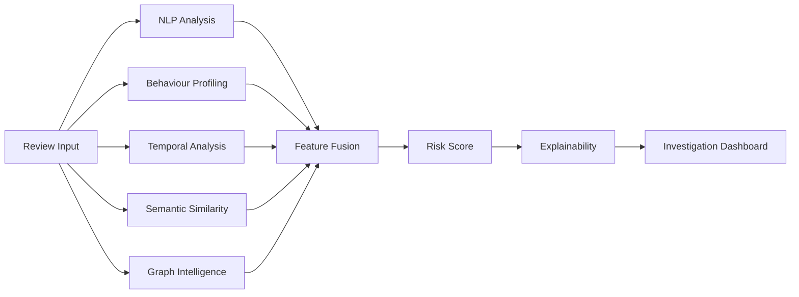

# ReviewShield AI

**AI-powered review fraud intelligence that combines language, behaviour, timing, similarity and network evidence.**

ReviewShield AI is a multi-modal AI system for online review fraud and coordinated manipulation detection. It is designed as an evidence-based risk assessment platform — not a single-signal fake review classifier.

## Problem

Text-only fake review detection misses coordinated manipulation, behavioural anomalies, temporal bursts, semantic duplication, and reviewer-product network patterns.

## Solution

ReviewShield AI fuses multiple evidence modalities:

- NLP and transformer embeddings
- Reviewer behaviour profiling
- Temporal pattern analysis
- Semantic similarity detection
- Graph-based coordination analysis
- Multimodal ML scoring
- Explainable AI

## Architecture



## Technology Stack

| Layer | Technologies |
|-------|-------------|
| Frontend | React, TypeScript, Vite, Tailwind CSS |
| Backend | Python, FastAPI, SQLAlchemy, Alembic, PostgreSQL |
| ML | scikit-learn, PyTorch, Hugging Face, sentence-transformers, XGBoost, SHAP, NetworkX |
| DevOps | Docker, Docker Compose, GitHub Actions |

## Project Structure

```
reviewshield-ai/
├── frontend/          # React dashboard
├── backend/           # FastAPI application
├── ml/                # Machine learning modules
├── data/              # Raw, processed, and sample data
├── scripts/           # Data and utility scripts
├── docs/              # Documentation
└── .github/workflows/ # CI/CD
```

## Getting Started

### Prerequisites

- Python 3.11+
- Node.js 20+
- PostgreSQL 15+ (for full backend; not required for Phase 1 health check)

### Installation

```bash
git clone https://github.com/shivanshehehe/reviewshield-ai.git
cd reviewshield-ai
cp .env.example .env
make install
```

### Development

```bash
# Terminal 1 — backend
make dev-backend

# Terminal 2 — frontend
make dev-frontend
```

- Frontend: http://localhost:5173
- Backend API: http://localhost:8000
- API docs: http://localhost:8000/docs
- Health check: http://localhost:8000/health

### Testing

```bash
make test
make lint
make build
```

## Current Status

**Phase 1 complete** — repository initialization with:

- Monorepo structure
- FastAPI backend with `/health` endpoint
- React frontend with backend connectivity check
- GitHub Actions CI
- Makefile and development tooling

See [PROJECT_STATUS.md](PROJECT_STATUS.md) for detailed progress.

## Limitations

This project is under active development. The system estimates fraud risk based on available evidence and must not be interpreted as definitive fraud proof.

## License

MIT — see [LICENSE](LICENSE).

## Author

Built by [shivanshehehe](https://github.com/shivanshehehe).
