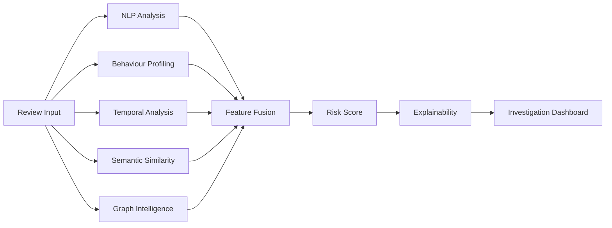

# ReviewShield AI

**AI-powered review fraud intelligence that combines language, behaviour, timing, similarity and network evidence.**

[](https://github.com/shivanshehehe/reviewshield-ai/actions)

Multi-Modal AI System for Online Review Fraud and Coordinated Manipulation Detection.

## Problem

Text-only fake review detection misses coordinated manipulation, behavioural anomalies, temporal bursts, semantic duplication, and reviewer-product network patterns.

## Solution

ReviewShield AI fuses five evidence modalities into an evidence-based risk assessment:

- **NLP** — lexical diversity, promotional language, sentiment proxy
- **Behaviour** — review volume, rating patterns, product diversity
- **Temporal** — burst detection, synchronized activity
- **Similarity** — Sentence-Transformers embeddings with FAISS (TF-IDF + numpy fallback)
- **Graph** — NetworkX reviewer-product network analysis

## Architecture



## Technology Stack

| Layer | Technologies |
|-------|-------------|
| Frontend | React 19, TypeScript, Vite, Tailwind CSS, Recharts |
| Backend | Python, FastAPI, SQLAlchemy, JWT |
| ML | scikit-learn, NetworkX, Sentence-Transformers (optional), FAISS (optional) |
| Database | SQLite (dev) / PostgreSQL + pgvector (Docker) |
| DevOps | Docker Compose, GitHub Actions |

## Quick Start

```bash
git clone https://github.com/shivanshehehe/reviewshield-ai.git
cd reviewshield-ai
cp .env.example .env
make install
make seed
```

```bash
# Terminal 1
make dev-backend

# Terminal 2
make dev-frontend
```

- **Frontend**: http://localhost:5173
- **API Docs**: http://localhost:8000/docs
- **Login**: admin / admin123

If demo accounts are missing from an existing database, run the user bootstrap
from the same working directory and with the same `DATABASE_URL` used by the
backend. For the default root-level SQLite database, run
`python backend/app/bootstrap.py` from the repository root. This creates or
repairs the demo account password hashes without reseeding review data.

## Docker

```bash
docker compose up --build
```

- Frontend: http://localhost:3000
- Backend: http://localhost:8000

## Dashboard Pages

1. **Overview** — risk statistics and classification distribution
2. **Analyzer** — submit and analyze review text
3. **Investigation** — browse reviews with predictions
4. **Reviewers** — reviewer risk intelligence
5. **Products** — product-level intelligence
6. **Clusters** — coordinated fraud clusters
7. **Graph** — reviewer-product network explorer
8. **Analytics** — model performance metrics
9. **Settings** — system and model info

## Demo Credentials

| Role | Username | Password |
|------|----------|----------|
| Admin | admin | admin123 |
| Analyst | analyst | analyst123 |
| Viewer | viewer | viewer123 |

## Project Structure

```
reviewshield-ai/
├── frontend/          # React investigation dashboard
├── backend/           # FastAPI + SQLAlchemy
├── ml/                # NLP, behavior, temporal, similarity, graph, fusion
├── scripts/           # Data pipeline + demo seeding
├── docs/              # Architecture, methodology, API docs
└── docker-compose.yml
```

## Testing

```bash
make test        # Backend + ML tests
make lint        # Ruff + ESLint
make build       # Frontend production build
```

## Limitations

- Seeded dashboard data is **demo data** (deterministic seed=42) unless you ingest Amazon/Yelp files
- Risk scores are **estimates**, not proof of fraud
- Sentence-Transformers/FAISS are optional; CI uses TF-IDF + numpy
- Analyzer live scoring does **not** write reviews or predictions

## Agent guide

See [AGENTS.md](AGENTS.md) for the project contract used by coding agents.

## License

MIT — see [LICENSE](LICENSE).

## Author

[shivanshehehe](https://github.com/shivanshehehe)
